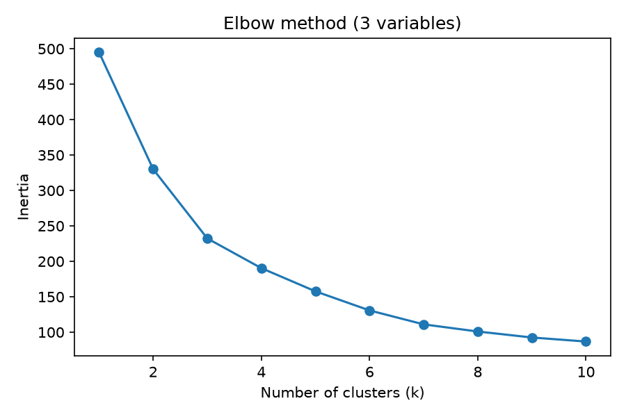
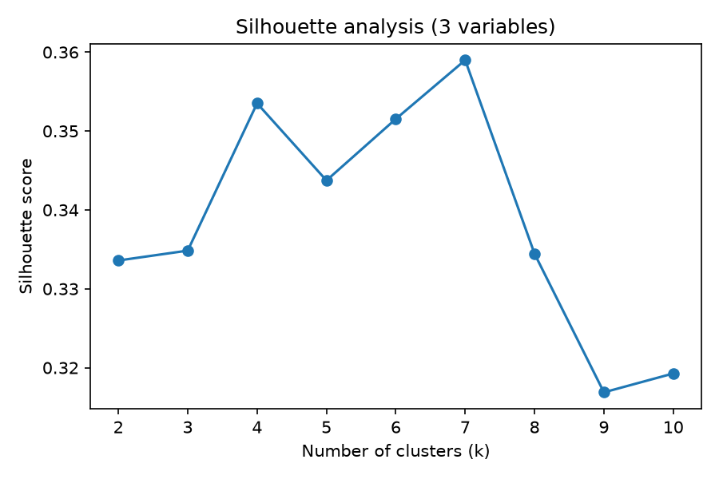

# Clustering Countries by Economic Development

K-means clustering of 165 countries on 20-year averages (2000–2020) of World Bank development indicators, to see
whether countries fall into distinct development "types" and how that picture changes when human-development
variables are added.

**Tools:** Python · pandas · NumPy · scikit-learn (StandardScaler, KMeans, silhouette score) · Matplotlib

## Question

Using only income level, GDP growth and population growth, can countries be grouped meaningfully, and do the
groups change once tertiary education enrolment and life expectancy are added?

## Approach

1. **Data audit:** descriptive statistics and a missing-value check across 217 countries and 8 indicators.
2. **Missing data:** listwise deletion (217 → 165 countries), since K-means cannot handle gaps. The resulting
   bias is discussed under Limitations.
3. **Standardisation** so that log income levels and percentage growth rates count equally in the distance metric.
4. **Choosing *k*** with the elbow method and silhouette analysis, for both specifications.
5. **Interpretation:** centroids converted back to original units, a cross-tabulation by world region, and
   comparisons of country size and of government and health spending across clusters.

## Key findings

| Spec | Cluster | Profile | Label |
|---|---|---|---|
| 3 variables | 0 | highest income, slow growth (1.2%) | Developed |
| 3 variables | 1 | lowest income, fastest population growth (2.8%) | Developing |
| 3 variables | 2 | middle income, fastest GDP growth (4.2%) | Emerging |
| 5 variables | 0 | lowest income, 7.6% tertiary enrolment, life expectancy 59.7 | Developing |
| 5 variables | 1 | middle income, fastest growth (3.7%) | Emerging |
| 5 variables | 2 | highest income, 58.8% enrolment, life expectancy 78.6 | Developed |

- **Human-development variables sharpen the split.** Adding enrolment and life expectancy makes the developed
  cluster richer and the developing cluster poorer on average.
- **Geography:** the developing cluster is concentrated in Sub-Saharan Africa (34 countries, rising to 40 in the
  5-variable model). The emerging cluster is the most geographically diverse and grows to 62 countries.
- **Policy:** more developed clusters spend a larger share of GDP on government (≈18.7% vs ≈15%) and on health
  (≈7.7% vs ≈5%).
- **Country size** hardly differs across clusters.

| Elbow (3 variables) | Silhouette (3 variables) |
|---|---|
|  |  |

## Limitations

- The 52 countries dropped for missing data are likely to be poorer economies with weaker statistical systems,
  so the results lean towards well-measured countries.
- For the 3-variable model the silhouette score peaks at k = 7, which conflicts with the elbow method. k = 3 is
  therefore a judgement call.
- Outliers were kept on purpose because they are real values, but they pull the K-means centroids towards them.

## Run it

```bash
pip install -r requirements.txt
jupyter notebook country_clustering.ipynb
```

## Data

`data/wdi_country_trajectories_20y.csv` contains country-level 2000–2020 averages derived from the
[World Bank World Development Indicators](https://datacatalog.worldbank.org/search/dataset/0037712), licensed under
[CC BY 4.0](https://creativecommons.org/licenses/by/4.0/).

## About

This started as coursework for *Methods for Data Analytics II* (BSc Economics and Data Analytics, University of
Leicester, 2025/26) and was reworked into a standalone portfolio notebook. The analysis and code are my own; the
notebook was restructured for presentation with help from Claude Code.

**Yash Karavadra** · [LinkedIn](https://www.linkedin.com/in/yash-karavadra-88619b330/)
